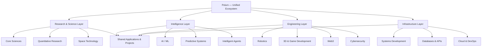

# ⌬ Polum
 
### Frontier Technology · Computational Science · Intelligent Engineering

**Engineering Intelligence. Exploring Frontiers. Building Beyond Boundaries.**

[](#)
[](LICENSE)
[](#-technology-divisions)
[](#-contributing)

**Polum** is a multidisciplinary technology and engineering ecosystem bringing together advanced computing, artificial intelligence, mathematical sciences, financial engineering, cybersecurity, decentralized technologies, robotics, and digital creation.

Designed as a unified environment for exploring ideas, conducting computational experiments, developing intelligent applications, and engineering solutions across interconnected technological domains.

> From mathematical abstractions to intelligent machines, from digital infrastructure to the frontiers of space — one ecosystem, limitless possibilities.

---

## ◈ Table of Contents

- [Overview](#-overview)
- [Vision & Mission](#-vision--mission)
- [Technology Divisions](#-technology-divisions)
- [Core Capabilities](#-core-capabilities)
- [Technology Stack](#-technology-stack)
- [System Architecture](#-system-architecture)
- [Repository Structure](#-repository-structure)
- [Development Roadmap](#-development-roadmap)
- [Getting Started](#-getting-started)
- [Contribution Guidelines](#-contribution-guidelines)

---

## ◈ Overview

Modern technological breakthroughs rarely exist within a single discipline. Artificial intelligence intersects with scientific research, quantitative finance relies on mathematical modelling, robotics depends on control theory, and space engineering increasingly depends on intelligent autonomous systems.

Polum aims to bring these interconnected disciplines into one collaborative development ecosystem.

### What Polum brings together

- **Research:** Explore scientific concepts, mathematical models, and emerging technologies.
- **Engineering:** Design, develop, and test computational and physical systems.
- **Intelligence:** Build AI-powered applications, predictive models, and autonomous agents.
- **Simulation:** Experiment with financial markets, physical environments, robotic systems, and digital worlds.
- **Infrastructure:** Develop secure, scalable, and high-performance software systems.
- **Innovation:** Transform interdisciplinary ideas into functional projects and prototypes.

---

## ◈ Vision & Mission

### Vision

To establish an integrated environment where scientific research, computational intelligence, and engineering innovation converge to solve complex real-world problems.

### Mission

1. Bridge the gap between theoretical science and practical engineering.
2. Encourage interdisciplinary research and development.
3. Build accessible tools for experimentation, simulation, and innovation.
4. Explore emerging technologies through open-source development.
5. Develop scalable, secure, and intelligent technological solutions.
6. Foster collaboration between researchers, developers, engineers, and enthusiasts.

---

## ◈ Technology Divisions

### 01. Aerospace & Space Technology
<sub>ASTRO · AEROSPACE · EXPLORATION</sub>

Exploring computational aerospace engineering, orbital mechanics, space systems, and intelligent exploration.

- Orbital Mechanics & Astrodynamics
- Rocket Propulsion & Flight Dynamics
- Satellite & Spacecraft Systems
- Mission Planning & Trajectory Optimization
- Space Navigation & Guidance Systems
- Astronomy & Astrophysical Computing
- Remote Sensing & Geospatial Intelligence
- Space Simulation & Mission Analysis

**Technologies:** MATLAB, Simulink, Astropy, Orekit, GMAT, SPICE, OpenFOAM, Python.

### 02. Artificial Intelligence & Machine Learning
<sub>INTELLIGENCE · LEARNING · AUTONOMY</sub>

Developing intelligent computational systems capable of learning, reasoning, prediction, and autonomous decision-making.

- Machine Learning & Deep Learning
- Generative AI & Large Language Models
- Computer Vision & Image Processing
- Natural Language Processing
- Reinforcement Learning
- Neural Networks & Transformers
- AI Agents & Multi-Agent Systems
- MLOps & Model Infrastructure
- Scientific Machine Learning

**Technologies:** PyTorch, TensorFlow, JAX, Scikit-learn, OpenCV, Hugging Face, LangChain.

### 03. Quantitative Finance & Fintech
<sub>QUANTITATIVE · FINANCIAL · COMPUTATIONAL</sub>

Applying mathematics, statistics, algorithms, and high-performance computing to financial systems.

- Quantitative Research
- Algorithmic & High-Frequency Trading
- Statistical Arbitrage
- Financial Mathematics & Stochastic Calculus
- Portfolio Optimization
- Risk Modelling & Management
- Market Microstructure
- Financial Forecasting & Time-Series Analysis
- Computational Economics

**Technologies:** Python, C++, R, NumPy, SciPy, QuantLib, Statsmodels, CVXPY, Backtrader.

### 04. Cybersecurity & Cryptography
<sub>SECURITY · DEFENCE · PRIVACY</sub>

Engineering secure systems, researching vulnerabilities, and exploring the foundations of digital trust.

- Network & Application Security
- Ethical Hacking & Penetration Testing
- Cryptography & Cryptanalysis
- Reverse Engineering
- Digital Forensics
- Binary Exploitation
- Secure Software Engineering
- Cloud & Infrastructure Security
- Threat Detection & Security Automation

**Technologies:** Kali Linux, Wireshark, Burp Suite, Ghidra, Nmap, Metasploit, GDB, OWASP ZAP.

### 05. Web3 & Decentralized Technologies
<sub>BLOCKCHAIN · DISTRIBUTED · TRUSTLESS</sub>

Exploring decentralized architectures, cryptographic protocols, and next-generation digital infrastructure.

- Blockchain Architecture
- Smart Contracts & DApps
- Decentralized Finance
- Zero-Knowledge Proofs
- Distributed Ledger Technologies
- Decentralized Identity
- Tokenization & Cryptographic Protocols
- Peer-to-Peer Networks
- Decentralized Storage

**Technologies:** Solidity, Ethereum, Foundry, Hardhat, Ethers.js, IPFS, OpenZeppelin.

### 06. Core Sciences & Computational Research
<sub>MATHEMATICS · PHYSICS · QUANTUM · BIOLOGY</sub>

Investigating scientific principles through computational modelling, numerical methods, and mathematical experimentation.

- Applied Mathematics & Mathematical Modelling
- Computational Physics
- Quantum Computing & Quantum Information
- Nanotechnology & Materials Science
- Computational Chemistry
- Bioinformatics & Computational Biology
- Numerical Analysis
- Probability & Statistical Mechanics
- Scientific Simulation & Optimization

**Technologies:** MATLAB, Mathematica, SciPy, NumPy, SymPy, Qiskit, PennyLane, Astropy.

### 07. Robotics & Autonomous Systems
<sub>ROBOTICS · EMBEDDED · CONTROL</sub>

Designing intelligent machines and autonomous systems that interact with the physical world.

- Robot Kinematics & Dynamics
- Autonomous Navigation
- SLAM & Sensor Fusion
- Computer Vision for Robotics
- Control Systems & Mechatronics
- Embedded Systems & Firmware
- Autonomous Vehicles
- Human-Robot Interaction
- Industrial Automation
- Simulation & Digital Twins

**Technologies:** ROS 2, Gazebo, Webots, Arduino, Raspberry Pi, ESP32, PX4, FreeRTOS.

### 08. 3D Modelling, Graphics & Game Development
<sub>VISUALIZATION · SIMULATION · CREATION</sub>

Building digital environments, computational graphics, interactive simulations, and immersive experiences.

- 3D Modelling & Asset Creation
- Procedural Modelling
- Computer Graphics & Rendering
- Game Engine Development
- Real-Time Physics Simulation
- Shader Programming
- Animation & Rigging
- CAD & Computational Geometry
- Digital Twins
- Virtual & Interactive Environments

**Technologies:** Blender, Unreal Engine, Unity, Godot, Three.js, OpenGL, Vulkan, Substance 3D.

### 09. Systems Development & Computer Engineering
<sub>LOW-LEVEL · INFRASTRUCTURE · PERFORMANCE</sub>

Engineering the software and hardware foundations that power modern computing.

- Operating Systems & Kernel Development
- Systems Programming
- Compiler & Language Design
- Computer Architecture
- Embedded Computing
- Distributed & Concurrent Systems
- Database & Storage Engines
- Networking & Protocol Engineering
- High-Performance Computing
- Cloud Infrastructure & DevOps
- Developer Tools & Automation

**Technologies:** C, C++, Rust, Linux, LLVM, GCC, CMake, Docker, Kubernetes, QEMU, PostgreSQL.

---

## ◈ Core Capabilities

Polum is organized around capabilities that can be shared across its nine divisions.

| Capability | Description |
|---|---|
| Research Lab | Scientific exploration and computational experiments |
| AI Engine | Machine learning, inference, and intelligent automation |
| Simulation Lab | Virtual modelling and real-world system simulation |
| Quant Engine | Financial computation and statistical modelling |
| Security Lab | Security testing and cryptographic experimentation |
| Distributed Core | Decentralized applications and distributed infrastructure |
| Robotics Lab | Embedded development and autonomous systems |
| Digital Studio | 3D assets, graphics, and interactive environments |
| Systems Core | Performance-oriented software and infrastructure |

---

## ◈ Technology Stack

### Programming Languages


### Development & Infrastructure


### Data, Cloud & Databases

`PostgreSQL` · `MySQL` · `MongoDB` · `Redis` · `Supabase` · `AWS` · `Azure` · `GCP` · `Terraform`

*The technology stack is an evolving ecosystem. Individual tools are adopted according to project requirements.*

---

## ◈ System Architecture

Polum follows a modular architecture designed to allow independent development while supporting interoperability between divisions.



### Architectural Principles

- Modular and loosely coupled components.
- Independent development of technology divisions.
- Shared libraries and reusable computational modules.
- API-first communication where appropriate.
- Secure-by-design development.
- Reproducible experiments and documentation.
- Scalable infrastructure and maintainable code.

---

## ◈ Repository Structure

```text
Polum/
│
├── aerospace/
│   ├── astrodynamics/
│   ├── propulsion/
│   ├── satellite-systems/
│   └── mission-simulation/
│
├── artificial-intelligence/
│   ├── machine-learning/
│   ├── deep-learning/
│   ├── generative-ai/
│   └── computer-vision/
│
├── quantitative-finance/
│   ├── algorithmic-trading/
│   ├── financial-modelling/
│   ├── portfolio-optimization/
│   └── market-analysis/
│
├── cybersecurity/
│   ├── cryptography/
│   ├── network-security/
│   ├── reverse-engineering/
│   └── security-research/
│
├── web3/
│   ├── blockchain/
│   ├── smart-contracts/
│   ├── decentralized-apps/
│   └── cryptographic-protocols/
│
├── core-sciences/
│   ├── mathematics/
│   ├── computational-physics/
│   ├── quantum-computing/
│   ├── nanotechnology/
│   └── bioinformatics/
│
├── robotics/
│   ├── embedded-systems/
│   ├── autonomous-systems/
│   ├── ros2/
│   └── control-systems/
│
├── digital-creation/
│   ├── 3d-modelling/
│   ├── computer-graphics/
│   ├── game-development/
│   └── simulations/
│
├── systems-development/
│   ├── operating-systems/
│   ├── compilers/
│   ├── networking/
│   └── distributed-systems/
│
├── shared/
│   ├── libraries/
│   ├── utilities/
│   └── configurations/
│
├── docs/
├── scripts/
├── tests/
├── examples/
│
├── .github/
│   ├── workflows/
│   └── ISSUE_TEMPLATE/
│
├── CONTRIBUTING.md
├── CODE_OF_CONDUCT.md
├── LICENSE
└── README.md
```

---

## ◈ Development Roadmap

- [x] Establish the foundational repository architecture.
- [ ] Create documentation and contribution guidelines.
- [ ] Set up shared development environments.
- [ ] Establish all nine technology divisions.
- [ ] Develop reusable libraries and utilities.
- [ ] Introduce automated testing and CI/CD.
- [ ] Build initial projects and research prototypes.
- [ ] Integrate AI-powered computational tools.
- [ ] Develop simulation and visualization environments.
- [ ] Introduce cross-domain integrations.
- [ ] Expand community contributions.
- [ ] Establish a unified project dashboard.

### Future Integrations

- AI-assisted research and development.
- Scientific computation and simulation engines.
- Autonomous system experimentation.
- Quantitative analytics infrastructure.
- Secure decentralized services.
- Interactive 3D visualization environments.
- High-performance computing infrastructure.

---

## ◈ Getting Started

### Prerequisites

- Git
- Python 3.11+
- C/C++ toolchain
- Node.js and npm
- Linux, macOS, or Windows with WSL

Additional dependencies vary between divisions.

### Clone the Repository

```bash
git clone https://github.com/ASAN-11/Polum.git

cd Polum
```

### Explore a Division

```bash
cd artificial-intelligence
```

Follow the individual project's documentation for environment setup and execution.

> Polum is modular. You do not need to install every technology or dependency to work on an individual division.

---

## ◈ Contributing

Polum welcomes developers, researchers, engineers, designers, and technology enthusiasts interested in interdisciplinary innovation.

### How to Contribute

1. Explore the existing divisions.
2. Identify an issue or propose a new idea.
3. Fork the repository.
4. Create a feature branch.
5. Implement and test your contribution.
6. Submit a pull request with appropriate documentation.

### Contribution Areas

- New research implementations.
- Algorithms and computational models.
- Engineering prototypes.
- AI/ML experiments.
- Security tools and research.
- Simulation environments.
- Documentation and educational resources.
- Performance improvements and infrastructure.

Please review `CONTRIBUTING.md` before submitting contributions.

---

## ◈ Documentation & Resources

| Resource | Description |
|---|---|
| Documentation | Technical documentation and project guides |
| Research | Papers, experiments, and computational studies |
| Examples | Demonstrations and reference implementations |
| Discussions | Ideas, collaboration, and technical discussions |
| Issues | Bugs, feature requests, and development tasks |

---

<div align="center">

### ⌬ BEYOND CONVENTIONAL BOUNDARIES.

**One Ecosystem. Nine Disciplines. Infinite Possibilities.**

*Built for exploration. Engineered for innovation.*

</div>
